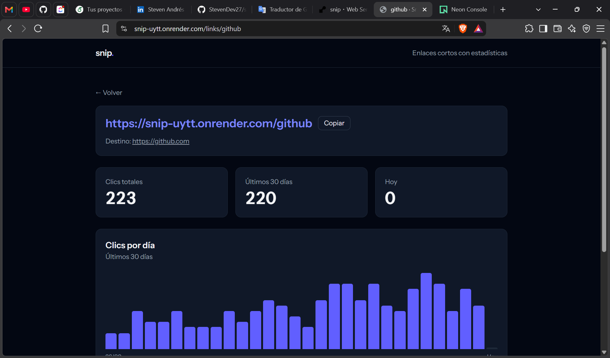

# Snip

Acortador de URLs con estadísticas de clics. Pegas un enlace largo, obtienes uno corto y ves cuántos clics recibe cada día y desde dónde llegan las visitas.

**Demo:** <https://snip-uytt.onrender.com>
(El servicio gratuito se duerme tras 15 minutos sin visitas; la primera carga puede tardar cerca de un minuto.)

Prueba el panel de un enlace de ejemplo: <https://snip-uytt.onrender.com/links/github>



## Qué hace

- Genera un código corto de 6 caracteres y redirige al destino original.
- Registra cada clic con su fecha, la página de origen (`Referer`) y el navegador (`User-Agent`).
- Muestra por enlace: clics totales, clics de los últimos 30 días, clics de hoy, gráfico por día y principales orígenes.
- Permite definir una fecha de caducidad; pasada esa fecha, el enlace responde `410 Gone`.
- Cada visitante ve solo los enlaces que creó (cookie anónima, sin registro), además de los enlaces de ejemplo.

## Stack

- **Backend:** Laravel 13, PHP 8.4
- **Base de datos:** PostgreSQL (Neon en producción)
- **Frontend:** Blade + Tailwind CSS v4 + Vite, sin librerías de gráficos (las barras son HTML y Tailwind)
- **Pruebas:** Pest
- **Despliegue:** Docker (FrankenPHP) en Render

## Decisiones técnicas

- **Redirección `302`, no `301`.** Un `301` lo guarda en caché el navegador, así que los clics siguientes ya no llegarían al servidor y no se contarían.
- **Índice compuesto `(link_id, clicked_at)`.** Las consultas más frecuentes filtran por enlace y rango de fechas, y este índice las cubre.
- **Agregaciones en la base de datos.** Los clics por día y los orígenes se calculan con `GROUP BY` (`DATE(clicked_at)`, `referer`), no cargando filas en memoria. Los días sin clics se rellenan con 0 en PHP.
- **Caché de 60 segundos** en las estadísticas de cada enlace. Reduce las consultas de agregación a cambio de que el panel pueda ir hasta un minuto atrasado. Una prueba cubre ese comportamiento.
- **Solo URLs `http` y `https`.** Se validan en un Form Request, por lo que valores como `javascript:` no pueden guardarse ni terminar en un `href`.
- **Límite de peticiones** (`throttle`, 20 por minuto) al crear enlaces, para evitar abuso en una demo pública.
- **Sin datos personales.** No se guarda IP ni ubicación; solo fecha, origen y navegador.

## Limitaciones conocidas

- El origen depende de la cabecera `Referer`, que no siempre se envía. Las visitas directas y muchas apps móviles quedan sin origen.
- Los clics por día se agrupan en UTC.
- La identificación del visitante es una cookie anónima: si la borra, deja de ver sus enlaces. Los enlaces siguen funcionando.
- Cualquiera que conozca el código de un enlace puede ver su panel de estadísticas.

## Ejecutarlo en local

Requisitos: PHP 8.4+, Composer, Node 22+ y PostgreSQL con las extensiones `pdo_pgsql` y `pgsql` activas.

```bash
git clone https://github.com/StevenDev27/snip.git
cd snip

composer install
npm install
cp .env.example .env
php artisan key:generate
```

Crea dos bases de datos en PostgreSQL (`snip` para desarrollo y `snip_testing` para pruebas) y configura `.env`:

```env
DB_CONNECTION=pgsql
DB_HOST=127.0.0.1
DB_PORT=5432
DB_DATABASE=snip
DB_USERNAME=postgres
DB_PASSWORD=tu_contraseña
```

Luego:

```bash
php artisan migrate
php artisan db:seed --class=LinkSeeder   # enlaces de ejemplo con clics de 30 días
composer run dev
```

La aplicación queda en <http://localhost:8000>.

## Pruebas

```bash
php artisan test --compact
```

Las pruebas usan la base `snip_testing` (ver `phpunit.xml`) y la reinician en cada ejecución, por eso no debe ser la misma que la de desarrollo.

## Despliegue

El repositorio incluye un `Dockerfile` y un `render.yaml` para desplegar en [Render](https://render.com) con una base de datos [Neon](https://neon.tech). Al iniciar, el contenedor ejecuta las migraciones y deja las cachés de producción listas.

Variables de entorno necesarias:

| Variable | Valor |
| --- | --- |
| `APP_KEY` | Resultado de `php artisan key:generate --show` |
| `APP_URL` | URL pública del servicio |
| `DB_URL` | Cadena de conexión de Neon (con `sslmode=require`) |
| `RUN_DEMO_SEED` | `true` solo en el primer despliegue para cargar los enlaces de ejemplo |

El endpoint `/up` responde sin consultar la base de datos, así que sirve para el health check y para un monitor externo.

## Autor

Steven Andrés Pájaro Lizarazo
